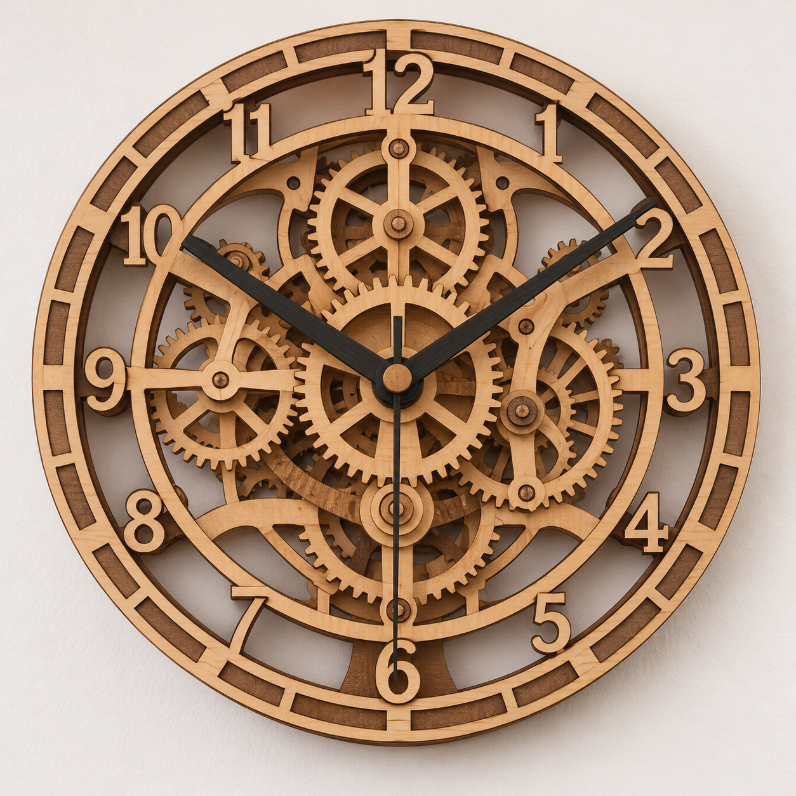

# The Mechanical Clock Project Plan
This file tracks the logistics of the project and a forecast on what is planned to be made.

## Bills of Materials (BOM)

For more information, check [BOM.csv](BOM.csv)

## Mechanical Clock Plan
### Clock Face
A conceptual design for the clock face itself. 


### The gears
My requirements for the 3 hands is to have a ratio of 

```1 : 60 : 72; seconds : minutes : hours```

This means that my gears must be in the Ratio. For now, my specific motor has not been specified, so I will be assuming it runs at 1 RPM. This is the exact speed I need for the seconds hand (because 1 revolution must completed in 60 seconds). This will obviously not be the actual scenario, for which reason I will attach a gear box to the motor to reduce the speed and increase the torque.

I will then base all of my gears off of the seconds hand, because they will be even slower. The gear ratio will be in the same ratio as the speed of each hand. 

For the gear connections, theoretically it will look like as follows.

Motor Box Output - 10T **[Anticlockwise rotation]**

**Seconds Hand** - ```Motor Box Output``` - 10T **[Clockwise rotation]**

**Minutes Hand** - ```Seconds Hand``` - 10T - 60T - 12T - 120T **[Clockwise rotation]**

*However, in the Minutes one, the 60T and 12T will be attached to each other rather than in series*

**Hours Hand** - ```Minutes Hand``` - 10T - 120T **[Clockwise rotation]**
*However, in the Hours one, the 10T and the 120T from the Minutes hand will be connected on the same shaft rather than in series*

---

To ensure that my gears themseleves can have depth, and connect in different ways, I will be using the same thickness of MDF, however I will glue multiple gear heads (of the same and different size and teeth) to add depth and allow for some more advanced features.

I will only use spurs, no ints or racks as they are not needed for the functionality of the product.

To make for nicer aesthetics, I will print the numbers seperately to the main frame and later glue them on. I also plan to have two main frames, which hold together the axels, and an outer frame which is the actual body of the clock.

To further improve the aesthetics, I will place the gears symmetrically and add other decorative (non-functional) gears to balance the layout.

For the tubes connecting to the hands of the clocks, it is basically virtually impossible for these to be made of wood. Hence, I will be using brass or other metals to make it work.

Every part of the clock will be left as its original color, except for the hands of the clock, which will be painted (spray painted) black.

---